# Hungry Haste 🍔

**A Flutter + Firebase food delivery app with a web admin panel. Runs in your browser with no setup, thanks to a built-in demo mode.**

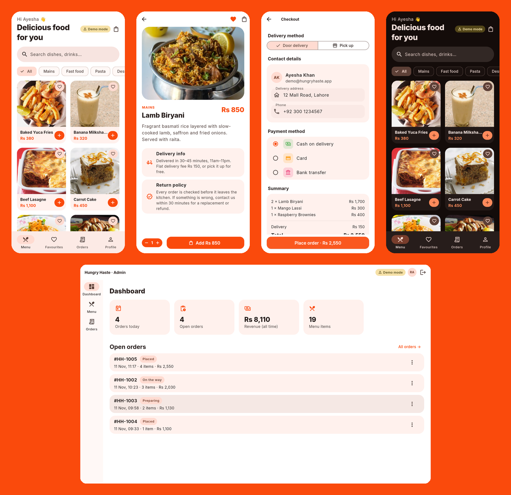

| Splash | Login | Menu | Food detail |
|---|---|---|---|
| 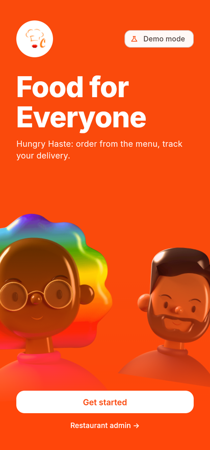 | 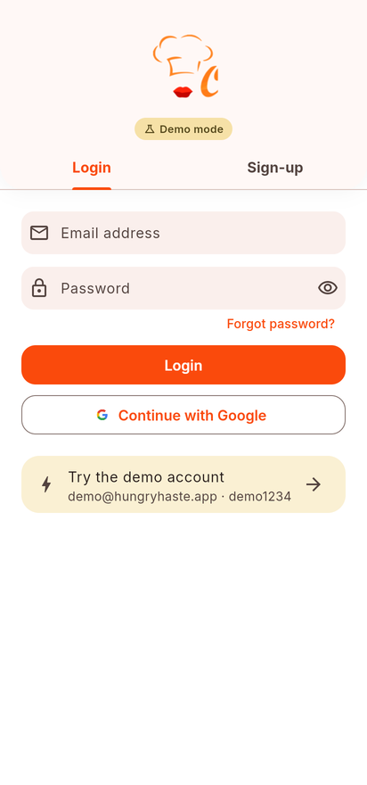 | 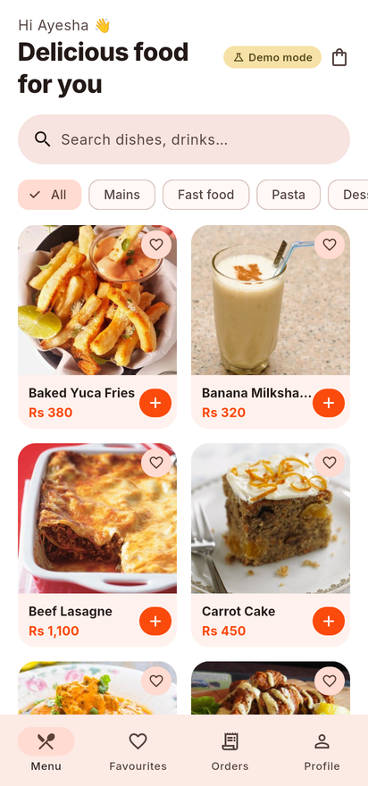 | 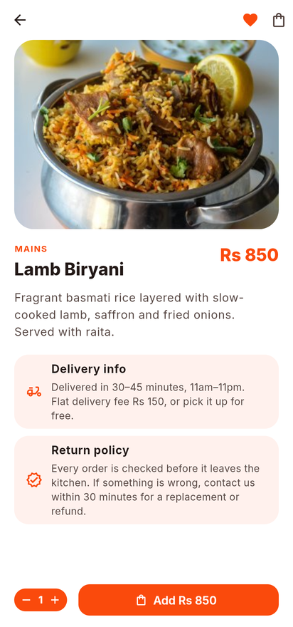 |

| Cart | Checkout | Order history | Dark mode |
|---|---|---|---|
| 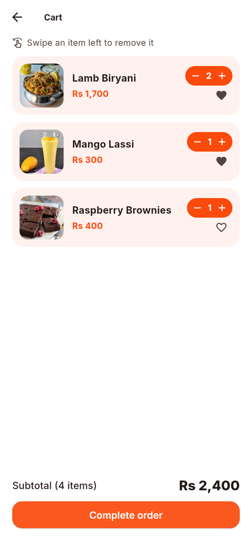 | 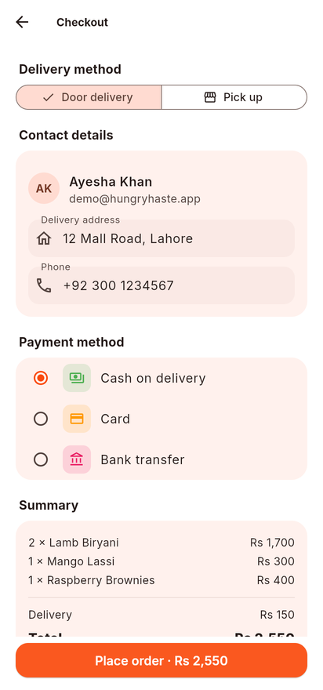 | 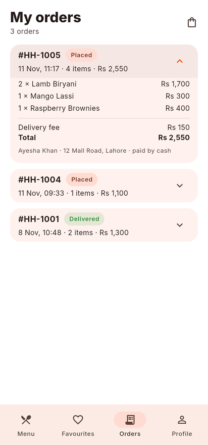 | 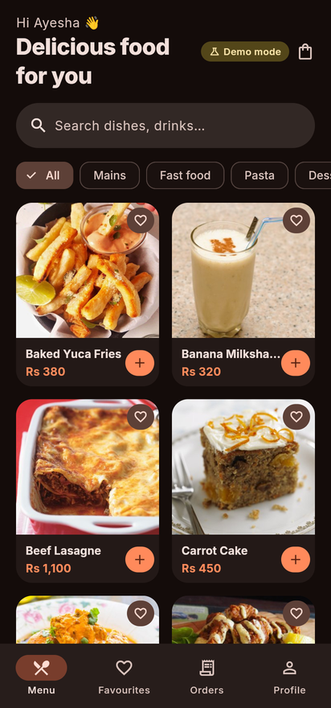 |

| Admin dashboard | Admin menu (CRUD) | Admin orders |
|---|---|---|
| 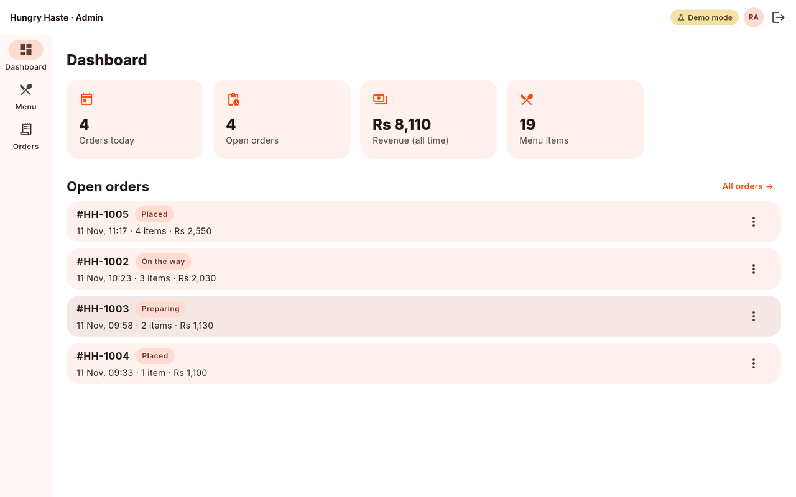 | 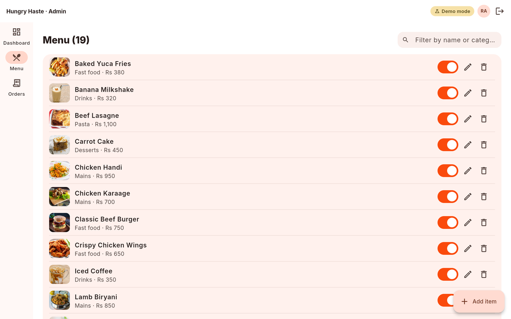 | 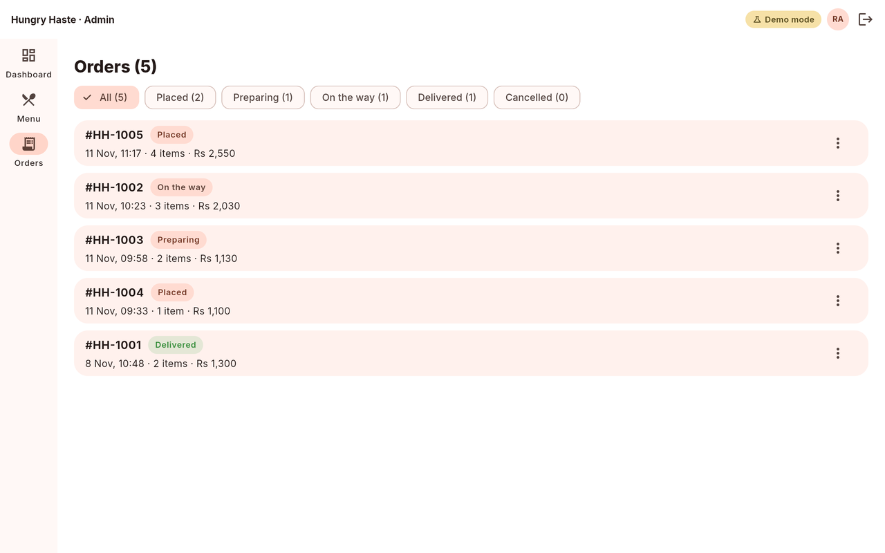 |

## Features

**Customer app**
- Onboarding splash, login / sign-up with email + password, **Continue with Google**, password reset
- Menu grid with **live search** and **category filters** (Mains, Fast food, Pasta, Desserts, Drinks)
- Food detail page, **favourites** (heart on any dish), cart with quantity steppers, swipe-to-remove with undo
- Checkout: door delivery or pick-up, address + phone from your profile, cash / card / bank, order confirmation
- **Order history** with live status (Placed → Preparing → On the way → Delivered)
- Profile editing with photo upload, **light / dark mode**

**Admin panel** (`/#/admin`, works best on a laptop screen)
- Separate admin login (only accounts with `role: 'admin'`)
- Dashboard: orders today, open orders, revenue, menu size
- Menu **CRUD**: add / edit / delete dishes, mark as sold out, one-click "load sample menu"
- Orders list with status filters; change any order's status and the customer sees it live

**Two backends behind one interface**
- **Demo mode** (default): no Firebase needed. Sample menu (19 dishes), demo accounts and orders, all stored in the browser's local storage so they survive a reload. A "Demo mode" badge shows when it's active.
- **Firebase mode**: Firebase Auth (email + Google), Cloud Firestore (menu, users, carts, orders), Cloud Storage (profile photos), with security rules in [`firestore.rules`](firestore.rules) and [`storage.rules`](storage.rules).

## Quick start (demo mode, no accounts needed)

Requires the [Flutter SDK](https://docs.flutter.dev/get-started/install) (stable, 3.35 or newer) and Chrome.

```bash
git clone <this-repo> hungry-haste && cd hungry-haste
flutter pub get
flutter run -d chrome
```

Click **Get started** → **Try the demo account**. For the admin panel, click **Restaurant admin →** on the splash screen (or open `/#/admin`) and use **Use demo admin account**.

| Demo account | Email | Password |
|---|---|---|
| Customer | `demo@hungryhaste.app` | `demo1234` |
| Admin | `admin@hungryhaste.app` | `admin1234` |

These accounts exist only in demo mode, inside your browser. "Reset demo data" on the Profile tab restores the original sample data.

To build a static site (e.g. for GitHub Pages / Firebase Hosting): `flutter build web --release` → `build/web/`.

## Connect your own Firebase project

The app picks its backend at start-up: if `lib/firebase_options.dart` holds a real config it uses Firebase, otherwise it falls back to demo mode. You can force one with `--dart-define=BACKEND=demo` or `--dart-define=BACKEND=firebase`.

1. **Create a project** at <https://console.firebase.google.com> (Analytics not needed).
2. **Enable services** in the console:
   - *Authentication → Sign-in method*: enable **Email/Password** and **Google**.
   - *Firestore Database → Create database* (production mode, any region).
   - *Storage → Get started* (needed only for profile photos; requires the Blaze plan on new projects, so you can skip it and everything else still works).
3. **Install the CLIs** (once):
   ```bash
   npm install -g firebase-tools
   dart pub global activate flutterfire_cli
   firebase login
   ```
4. **Generate the config** from the project folder:
   ```bash
   flutterfire configure --platforms=web,android
   git update-index --skip-worktree lib/firebase_options.dart
   ```
   This overwrites the placeholder `lib/firebase_options.dart` (and writes `android/app/google-services.json`, which is git-ignored). The second command stops git from picking up your keys.
5. **Paste the security rules**: copy [`firestore.rules`](firestore.rules) into *Firestore → Rules* and [`storage.rules`](storage.rules) into *Storage → Rules*, then **Publish**.
6. **Run it**: `flutter run -d chrome`. The badge now says *Firebase*. Sign up a normal account.
7. **Make yourself admin**: in *Firestore → users → (your uid)* add a field `role` = `admin` (string). Open `/#/admin`, sign in, and click **Load sample menu** to fill the `food` collection.

For Google sign-in on Android, also add your debug SHA-1 (`cd android && ./gradlew signingReport`) under *Project settings → Your apps*.

### Firestore layout

| Path | Contents |
|---|---|
| `food/{itemId}` | `name, price, category, image, description, available` (same `food` collection as the original version) |
| `users/{uid}` | `email, firstName, lastName, address, phone, imageUrl, favouriteFood[]`, optional `role: 'admin'` |
| `users/{uid}/cart/{itemId}` | `quantity` |
| `orders/{orderId}` | `uid, customerName, address, phone, lines[], deliveryFee, total, delivery, payment, status, createdAt` |

## Architecture

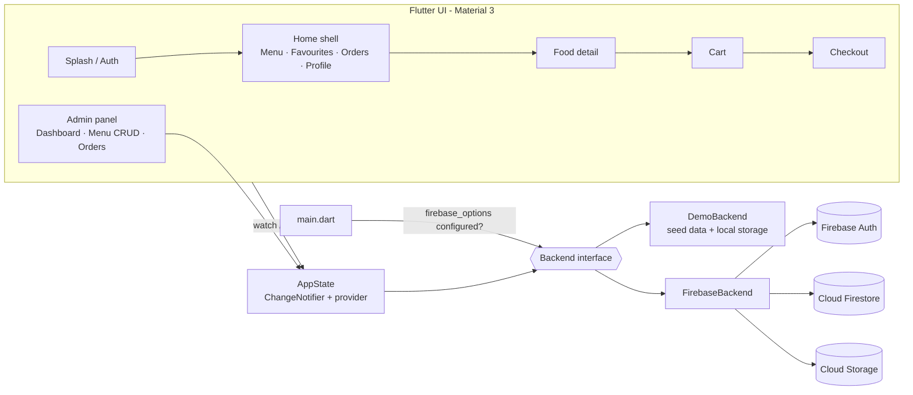

```
lib/
  main.dart              picks the backend (Firebase if configured, else demo)
  app.dart               routes, theme mode, auth guard
  theme.dart             Material 3 theme (seed #FA4A0C, Inter), Rs formatting
  models/models.dart     MenuItem, AppUser, CartLine, FoodOrder…
  data/backend.dart      Backend interface
  data/demo_backend.dart in-browser implementation
  data/firebase_backend.dart
  data/seed_data.dart    sample menu + demo accounts
  state/app_state.dart   user, live menu, cart, favourites, orders
  screens/               customer screens
  admin/                 admin login + admin shell
test/widget_test.dart    unit + widget tests (run against the demo backend)
```

## Tests

```bash
flutter analyze
flutter test
```

The tests drive the demo backend: login (wrong + right password), cart totals, placing an order, admin status change, favourites persisting across a reload, admin menu CRUD, and a widget test of the splash → demo login → search flow.

## Tech stack

Flutter 3 (web, Android, iOS) · Dart 3 · Material 3 · provider · Firebase Auth · Cloud Firestore · Cloud Storage · shared_preferences · image_picker · Inter font

## What changed in v2 (2026 rebuild)

The original 2023 version only ran against our private Firebase project, whose config can't be published. v2:
- adds the **demo mode** and the `Backend` interface so the app runs from a clean clone;
- adds the **web admin panel** (menu CRUD, order management, dashboard);
- upgrades to current Flutter / Firebase packages and Material 3 with light + dark themes;
- fixes bugs found in the audit: the search bar opened a route that didn't exist, the Foods tab was the only category with content, Google sign-in skipped creating the user profile (later screens crashed), adding a favourite wiped the other favourites, cart quantities were never saved, checkout showed a hard-coded name and address, orders weren't linked to the user and the cart wasn't cleared, order history / orders screens were static placeholders, and profile photo upload used `dart:io` (broke on web);
- replaces the SF Pro font (not redistributable) with Inter.

## Credits

- Food photos: [TheMealDB](https://www.themealdb.com) and [TheCocktailDB](https://www.thecocktaildb.com) (free for non-commercial use), bundled in `assets/menu/`.
- Illustrations (splash faces, logo) from the original UI design used by the project.
- Font: [Inter](https://rsms.me/inter/) by Rasmus Andersson (SIL Open Font License, `assets/fonts/Inter-LICENSE.txt`).

## Authors

Built by **Amna Choudhri** and **<partner>** (TODO: partner name/GitHub) as a university group project; v2 rebuild (demo mode, admin panel, Material 3) by Amna Choudhri.

## License

[MIT](LICENSE)
